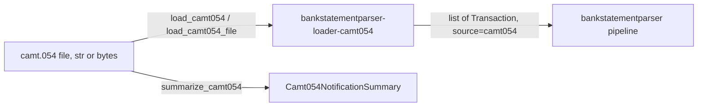

<!-- SPDX-License-Identifier: Apache-2.0 OR MIT -->

<p align="center">
  
</p>

<h1 align="center">bankstatementparser-loader-camt054</h1>

<p align="center">
  ISO 20022 camt.054 Bank-to-Customer Debit/Credit Notification loader that parses notification XML into bankstatementparser Transaction objects.
</p>

<p align="center">
  <a href="https://github.com/sebastienrousseau/bankstatementparser-loader-camt054/actions"></a>
  <a href="https://pypi.org/project/bankstatementparser-loader-camt054/"></a>
  <a href="https://sebastienrousseau.com/bankstatementparser-loader-camt054/"></a>
  <a href="https://scorecard.dev/viewer/?uri=github.com/sebastienrousseau/bankstatementparser-loader-camt054"></a>
  <a href="LICENSE"></a>
  <a href="https://github.com/sebastienrousseau/bankstatementparser-loader-camt054/blob/main/docs/POLICIES.md"></a>
</p>

<p align="center">
  
</p>

---

## Contents

**Getting started**

- [Install](#install): PyPI, source
- [Requirements](#requirements): toolchain floor, platforms
- [Quick Start](#quick-start): parse a file in three lines

**The bankstatementparser-loader-camt054 ecosystem**

- [The bankstatementparser-loader-camt054 ecosystem](#the-bankstatementparser-loader-camt054-ecosystem): the core library, the other loaders and writers

**Library reference**

- [Capabilities at a glance](#capabilities-at-a-glance): the current surface by theme
- [Ecosystem comparison](#ecosystem-comparison): short matrix; full table at [`docs/COMPARISON.md`](docs/COMPARISON.md)
- [Benchmarks](#benchmarks): headline numbers; full table at [`docs/BENCHMARKS.md`](docs/BENCHMARKS.md)
- [Features](#features): public API, element mapping, amounts and signs
- [Configuration](#configuration): core options
- [Examples](#examples): runnable example index

**Operational**

- [When not to use bankstatementparser-loader-camt054](#when-not-to-use-bankstatementparser-loader-camt054): limitations
- [Development](#development): make targets, fuzzing, CI
- [Security](#security): guarantees and compliance
- [Documentation](#documentation): all reference docs
- [Stability guarantees](#stability-guarantees): SemVer axis, output stability, minimum toolchain discipline
- [License](#license)

---

## Install

### As a Python library

```bash
pip install bankstatementparser-loader-camt054
```

That installs the loader, `defusedxml` and `bankstatementparser >= 0.0.36`, which brings `pandas` and `pydantic`.

| Channel | Command | Notes |
| :--- | :--- | :--- |
| PyPI | `pip install bankstatementparser-loader-camt054` | Pulls in `bankstatementparser >= 0.0.36` |
| Source | `git clone https://github.com/sebastienrousseau/bankstatementparser-loader-camt054 && cd bankstatementparser-loader-camt054 && poetry install` | For development |

Verify the installation:

```sh
python -c "import bankstatementparser_loader_camt054 as b; print(b.__version__)"
# -> 0.0.37
```

An isolated virtual environment keeps the loader's dependencies apart:

```sh
python -m venv venv
source venv/bin/activate        # macOS/Linux
venv\Scripts\activate           # Windows
python -m pip install -U bankstatementparser-loader-camt054
```

---

## Requirements

- **Python 3.10 or later.** CI tests CPython 3.10, 3.11, 3.12, 3.13 and 3.14 on Linux, macOS and Windows; [`docs/POLICIES.md`](docs/POLICIES.md) says when the floor moves.
- **[`bankstatementparser`](https://pypi.org/project/bankstatementparser/) 0.0.36 or later**, whose `Transaction` model and `BankStatementParser` base class the loader produces and extends.
- **[`defusedxml`](https://pypi.org/project/defusedxml/) 0.7**, for XML parsing. No network access, native extensions or system packages of its own.

---

## Quick Start

```python
from bankstatementparser_loader_camt054 import load_camt054_file

for txn in load_camt054_file("notification.xml"):
    print(txn.booking_date, txn.amount, txn.reference, txn.description)
```

Or parse an in-memory payload (a `str` or `bytes`):

```python
from bankstatementparser_loader_camt054 import load_camt054

payload = """<Document xmlns="urn:iso:std:iso:20022:tech:xsd:camt.054.001.08">
<BkToCstmrDbtCdtNtfctn><Ntfctn>
  <Acct><Id><IBAN>FR7630006000011234567890189</IBAN></Id></Acct>
  <Ntry>
    <Amt Ccy="EUR">1250.00</Amt><CdtDbtInd>CRDT</CdtDbtInd>
    <BookgDt><Dt>2026-01-15</Dt></BookgDt>
    <BkTxCd><Prtry><Cd>SEPA-CT</Cd></Prtry></BkTxCd>
    <NtryDtls>
      <TxDtls>
        <Refs><EndToEndId>INV-101</EndToEndId></Refs>
        <AmtDtls><TxAmt><Amt Ccy="EUR">1000.00</Amt></TxAmt></AmtDtls>
        <RmtInf><Ustrd>Invoice 101</Ustrd></RmtInf>
      </TxDtls>
      <TxDtls>
        <Refs><EndToEndId>INV-102</EndToEndId></Refs>
        <AmtDtls><TxAmt><Amt Ccy="EUR">250.00</Amt></TxAmt></AmtDtls>
        <RmtInf><Ustrd>Invoice 102</Ustrd></RmtInf>
      </TxDtls>
    </NtryDtls>
  </Ntry>
</Ntfctn></BkToCstmrDbtCdtNtfctn>
</Document>"""

for txn in load_camt054(payload):
    print(txn.booking_date, txn.amount, txn.reference, txn.description)
# 2026-01-15 1000.00 INV-101 SEPA-CT - Invoice 101
# 2026-01-15 250.00 INV-102 SEPA-CT - Invoice 102
```

Both return a flat `list` of `bankstatementparser.transaction_models.Transaction` objects with `source="camt054"`, one per `TxDtls` of a batched entry, ready for the rest of a `bankstatementparser` pipeline.

---

## The bankstatementparser-loader-camt054 ecosystem

bankstatementparser-loader-camt054 is one of the input loaders of the `bankstatementparser` suite, whose packages ship one version together. The full table is in [The suite](docs/suite.md).

| Component | Purpose | Use case |
| :--- | :--- | :--- |
| [`bankstatementparser`](https://github.com/sebastienrousseau/bankstatementparser) | The parser core: CAMT (including a one-row-per-entry `Camt054Parser`), pain.001, CSV, OFX, QFX, MT940, MT942, BAI2 and PDF statements, and the `Transaction` model | Parsing statements from Python or the CLI |
| **`bankstatementparser-loader-camt054`** | This loader: camt.054 XML to `Transaction` objects, one per payment of a batched entry, with the bank transaction code kept | Loading debit/credit notifications |
| Other loaders | BAI2, MT942, CFONB 120, SEPA pain.002 / pain.008 and BACS Standard 18 | Formats beyond the core |
| Writers and transport | XLSX, QIF, OFX and SWIFT writers; EBICS retrieval | Exporting transactions and fetching statements |
| [`bankstatementparser-mcp`](https://github.com/sebastienrousseau/bankstatementparser-mcp), [`bankstatementparser-lsp`](https://github.com/sebastienrousseau/bankstatementparser-lsp) | Agent tools and editor diagnostics over the core | AI agents and MT940 editing |



---

## Capabilities at a glance

| Area | Capability | Status |
| :--- | :--- | :--- |
| Loading | `load_camt054` (`str` or `bytes`) and `load_camt054_file` (path) to `list[Transaction]` | Shipped |
| Summary | `summarize_camt054` to a `Camt054NotificationSummary` (message id, creation time, account, currency, counts, credit and debit totals) | Shipped |
| Core integration | `Camt054StatementParser`, a `BankStatementParser` registered as `camt054` and `camt_054` in `bankstatementparser.loaders` | Shipped |
| Structure | Every `Ntfctn` and `Ntry`; one transaction per `TxDtls`, with the detail's own amount and currency when it has one | Shipped |
| Versions | Namespace-agnostic: `camt.054.001.02` to `.08` and unnamespaced documents | Shipped |
| Safety | `defusedxml` parsing: entity declarations and external references refused | Shipped |
| Schema validation | Checking a document against the camt.054 XSD | Not in this loader |
| Writing | Producing camt.054 | Not in this loader |

---

## Ecosystem comparison

The core `bankstatementparser` ships its own `Camt054Parser`. Both were run on `tests/fixtures/notification.xml` (a credit entry batching two transfers, and a Direct Debit); every cell comes from that run and the two projects' source.

| Project | Batched entry | Bank transaction code | `Transaction` objects |
| :--- | :---: | :---: | :---: |
| **bankstatementparser-loader-camt054** | One row per `TxDtls`, each with its amount | `category` `camt054:<code>` | Yes |
| `bankstatementparser` 0.0.35 `Camt054Parser` | One row per entry, remittance texts joined | Not read | DataFrame only |

---

## Benchmarks

`benches/bench_load_camt054.py` times `load_camt054` and `summarize_camt054` as a notification grows along both axes a real one grows: entries per notification, and transactions per batched entry. Cost per transaction stays flat from 10 to 10,000 entries (1.02x), a batched entry costs less per transaction, and a summary costs almost as much as a full load because both parse the whole document.

| Scenario | Result | Environment |
| :--- | ---: | :--- |
| `load_camt054`, 1,000 entries (416 KiB) | 53.98 ms | Apple M1 Pro, macOS 27.2.1, CPython 3.12.16 |
| `load_camt054`, 10,000 entries (4.1 MiB) | 580.16 ms | Apple M1 Pro, macOS 27.2.1, CPython 3.12.16 |
| `load_camt054`, 100 entries x 100 transactions (2.2 MiB) | 329.44 ms | Apple M1 Pro, macOS 27.2.1, CPython 3.12.16 |
| `summarize_camt054`, 10,000 entries (4.1 MiB) | 569.30 ms | Apple M1 Pro, macOS 27.2.1, CPython 3.12.16 |

See [`docs/BENCHMARKS.md`](docs/BENCHMARKS.md) for methodology and full results.

---

## Features

<!-- --8<-- [start:features] -->

### Public API

```python
from bankstatementparser_loader_camt054 import (
    Camt054NotificationSummary,
    Camt054StatementParser,
    load_camt054,
    load_camt054_file,
    summarize_camt054,
)
```

| Class / Function | Signature | Returns |
| :--- | :--- | :--- |
| `load_camt054` | `load_camt054(xml_content)`: a `str` or `bytes` | `list[Transaction]` |
| `load_camt054_file` | `load_camt054_file(path)`: a `str` or `os.PathLike` | `list[Transaction]` |
| `summarize_camt054` | `summarize_camt054(xml_content)`: a `str` or `bytes` | `Camt054NotificationSummary` |
| `Camt054StatementParser` | `Camt054StatementParser(file_name)` | `BankStatementParser` with `parse()` (DataFrame), `to_transactions()` and `get_summary()` (dict) |

`Camt054NotificationSummary` is a frozen dataclass with the fields `message_id` (`GrpHdr/MsgId`), `creation_date` (`GrpHdr/CreDtTm` as a `datetime`), `account_id` (the first notification's account), `currency` (the first transaction's), `notification_count`, `entry_count` (the number of transactions, so a batched entry counts once per `TxDtls`), `total_credit` and `total_debit` (both positive `Decimal`s).

### Element mapping

Elements are matched by local name, whatever the namespace. Each `Ntry` under each `Ntfctn` produces one transaction per `TxDtls`, or one transaction when it has none.

| `Transaction` field | Source |
| :--- | :--- |
| `account_id` | The notification's `Acct/Id/IBAN`, else the first `Id` text under `Acct` (for example `Othr/Id`) |
| `currency` | The `Ccy` of the amount used, else `EUR` |
| `amount` | `TxDtls` `TxAmt/Amt` (or `Amt`) when present and a decimal, else the entry's `Amt`; signed by `CdtDbtInd` |
| `booking_date` | `BookgDt/Dt` (or `DtTm`) |
| `value_date` | `ValDt/Dt` (or `DtTm`), else the booking date |
| `description` | The bank transaction code, then ` - ` and `RmtInf/Ustrd` for a `TxDtls`; `None` when both are absent |
| `reference` | `EndToEndId`, else `TxId`, else the detail's `AcctSvcrRef`, else the entry's `AcctSvcrRef` |
| `category` | `camt054:<code>`, the code being `BkTxCd/Prtry/Cd`, else `BkTxCd/Domn/Cd` (or text directly in `BkTxCd` or `Prtry`); `None` without one |
| `source`, `source_index` | `"camt054"` and the transaction's position in the document |

### Amount and sign convention

An ISO 20022 amount is unsigned: `CdtDbtInd` `CRDT` keeps it positive, anything else (`DBIT`, or a missing indicator) makes it negative. The amount must be ASCII digits with an optional fraction (`1250`, `89.90`); it becomes a `decimal.Decimal`, never a `float`. An entry whose `Amt` is anything else (`NaN`, `1e5`, `-5`, `1,000.00`) is skipped, and a detail amount that is anything else is ignored in favour of the entry's.

### Errors

`load_camt054`, `load_camt054_file` and `summarize_camt054` raise `xml.etree.ElementTree.ParseError` for a document that is not well-formed XML, and a `defusedxml` `DefusedXmlException` (a `ValueError`) for an entity declaration or an external reference. Inside a well-formed document, anything the loader does not model is skipped rather than guessed at. `load_camt054_file` raises `OSError` when the file cannot be read.

<!-- --8<-- [end:features] -->

---

## Configuration

The loader has no options, configuration file or environment variables: the element mapping and the sign convention above are fixed, so the same document always loads the same way. Installing the package registers `Camt054StatementParser` under the `camt054` and `camt_054` names in the `bankstatementparser.loaders` entry-point group, which is how the core discovers it; nothing needs to be configured for that.

---

## Examples

[`examples/`](examples/) holds two runnable scripts, each run in CI against an inline sample, so no data files are needed:

| Example | Demonstrates |
| :--- | :--- |
| [`01_basic_usage.py`](examples/01_basic_usage.py) | `load_camt054` and `summarize_camt054` on a one-entry notification |
| [`02_advanced_workflow.py`](examples/02_advanced_workflow.py) | Loading the same notification 100 times and totalling the absolute volume |

```sh
python examples/01_basic_usage.py
```

---

## When not to use bankstatementparser-loader-camt054

- **You have account statements or reports, not notifications.** camt.053 and camt.052 are read by the core's CAMT parsers.
- **You need the document validated against the XSD.** The loader reads what it models and skips the rest; it does not reject a document the schema would.
- **You need every element.** Balances, charges, structured remittance, related dates and most party details are not carried onto the `Transaction`.
- **You want a malformed amount refused.** An entry whose amount is not a decimal is skipped, not reported.

---

## Development

```bash
git clone https://github.com/sebastienrousseau/bankstatementparser-loader-camt054.git
cd bankstatementparser-loader-camt054
poetry install
make check
```

`make check` runs the local gates: `ruff` lint and format, `mypy --strict`, the complexity baseline (`scripts/check_complexity.py`), `bandit`, `pytest` with a 100% line + branch coverage floor, `interrogate` at 100% docstring coverage, and the examples. Other targets: `make fuzz` (Atheris, 60 s, Linux x86_64 with Python 3.12+), `make bench`, `make audit` (`pip-audit` on every locked set), `make docs` (the MkDocs manual, `--strict`) and `make demo` (re-renders the GIF above with VHS from `.github/demo.tape`). CI adds the OS by Python matrix, the fuzz run, CodeQL, `pip-audit` and the Docs Lint gates. [`CONTRIBUTING.md`](CONTRIBUTING.md) covers branches and commit signing.

---

## Security

- **Read-only.** The loader only reads the documents you pass it; it writes nothing.
- **Hardened XML parsing.** Every document goes through `defusedxml`, which refuses entity declarations (so no "billion laughs" expansion) and external entity or DTD references; there is no network access.
- **Decimal arithmetic** for every amount, and only a plain ISO 20022 decimal counts as one, so `NaN` or an exponent cannot reach a total.
- **Fuzzing.** `fuzz/fuzz_load_camt054.py` drives `load_camt054` and `summarize_camt054` with Atheris in CI, seeded with the repository's fixtures, and fails on any exception other than the XML parser's documented ones, any malformed `Transaction` and any disagreement between the load and the summary.
- **Supply chain.** Dependencies are locked in `poetry.lock`, CI installs hash-pinned exports of it, and `pip-audit` and CodeQL run on every change. Releases publish to PyPI through OIDC trusted publishing and carry cosign signatures, SLSA provenance and SBOMs; every workflow action is pinned by commit SHA except the SLSA generator, which must be referenced by tag.

Report vulnerabilities according to [`SECURITY.md`](SECURITY.md).

---

## Documentation

- **User manual:** [sebastienrousseau.com/bankstatementparser-loader-camt054](https://sebastienrousseau.com/bankstatementparser-loader-camt054/), built from [`docs/`](docs/) with MkDocs
- **API reference:** [the manual's API page](https://sebastienrousseau.com/bankstatementparser-loader-camt054/api/), generated from the docstrings
- **Developer docs:** [`CONTRIBUTING.md`](CONTRIBUTING.md), [`ARCHITECTURE.md`](ARCHITECTURE.md)
- **The suite:** [`docs/suite.md`](docs/suite.md), with every `bankstatementparser` package
- **History:** [`CHANGELOG.md`](CHANGELOG.md)
- **Project site:** [bankstatementparser.com](https://bankstatementparser.com)

---

## Stability guarantees

- **Versioning.** Releases stay on the `0.0.x` line and step by exactly `0.0.1`, in lockstep with the rest of the `bankstatementparser` suite. Under SemVer a `0.0.x` release may break anything; this project names each break in the CHANGELOG instead.
- **The breaking axis is the output**: which elements produce a `Transaction`, the sign of each amount, and how each `Transaction` field is filled. Changing any of them for a file that loaded before is a breaking change and is called out in the CHANGELOG, even when no Python signature moves.
- **Output stability.** The loader is deterministic: the same document gives the same transactions in the same order.
- **Python API.** `load_camt054`, `load_camt054_file`, `summarize_camt054`, `Camt054NotificationSummary` and `Camt054StatementParser` keep their names and fields; names starting with `_` are internal.
- **Minimum toolchain.** Python 3.10 is the floor; it moves only in a release, for the whole suite at once, with the reason in the CHANGELOG ([`docs/POLICIES.md`](docs/POLICIES.md)).

---

## License

Dual-licensed under [Apache License, Version 2.0](LICENSE-APACHE) or [MIT](LICENSE-MIT), at your option (`SPDX-License-Identifier: Apache-2.0 OR MIT`). Built on the core [`bankstatementparser`](https://github.com/sebastienrousseau/bankstatementparser) library. Any contribution submitted for inclusion in the work shall be dual-licensed as above, without additional terms or conditions.
